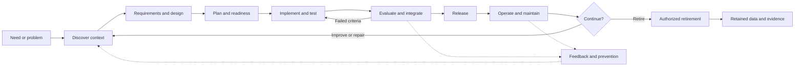
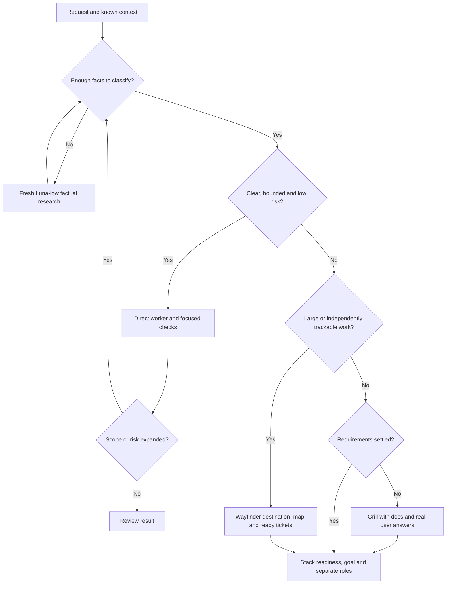
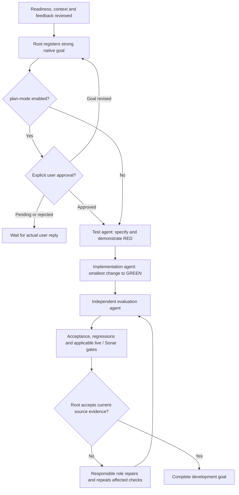
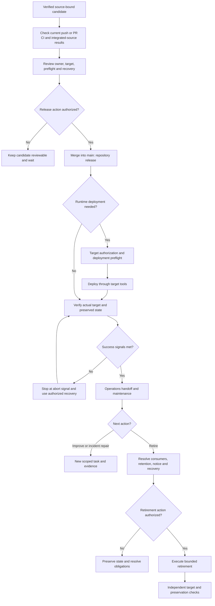

# SDLC & Workflow

KISS-Chris-Stack connects a software request to implementation, verification, release and the system's remaining life. It chooses a proportionate development route and carries evidence, ownership and preservation requirements into delivery, operation and retirement.

The root session coordinates; delegated roles do the substantive work. Skills prescribe the workflow, bundled helpers check specific contracts, and the project's own build, test, CI and operational tools execute its work. A diagram shows the intended process, not proof that a particular host, release or production recovery has executed it. The [shared policy](assets/global-stack-policy.md) owns the detailed rules.

## The complete lifecycle

Security, permissions, provenance and preservation apply throughout this loop. The same lifecycle can describe a plugin change or a downstream application, but each has its own target, owner, tools and authorization. A local documentation correction needs focused document checks; it does not need a fabricated running application or a deployment ceremony.

| Phase | Plugin skill or workflow | Responsibility, artifact and check |
| --- | --- | --- |
| Discover | [Research](skills/research/SKILL.md), CodeGraph and project context | Root assigns bounded factual questions; fresh Luna-low researchers retain source-linked facts, tests, feedback and unknowns. |
| Requirements | [Grill with docs](skills/grill-with-docs/SKILL.md) when unclear | Interview role prepares questions; root obtains real user answers. Settled acceptance criteria and terminology are retained. |
| Design | [Domain modeling](skills/domain-modeling/SKILL.md), [prototype](skills/prototype/SKILL.md) and UI-UX-Pro-Max where applicable | Substantive design/documentation roles record meaningful ADRs and domain terms; human feedback resolves prototype decisions. |
| Plan | [Orchestrator](skills/kiss-chris-stack/SKILL.md), [Wayfinder](skills/wayfinder/SKILL.md) for large work | Root owns strong goals, scope, dependencies, ticket claims and approval. Plans identify applicable security, delivery and recovery requirements. |
| Readiness | [Setup](skills/setup/SKILL.md) and [tracker binding](docs/WAYFINDER.md) | Runtime checks, current CodeGraph index, actual session MCP call and configured tracker checks precede stack implementation. |
| Test specification | Separate test role | Observable acceptance tests demonstrate RED before implementation; document and contract checks suit documentation-only goals. |
| Implementation | Separate implementation role, [Ponytail](skills/ponytail/SKILL.md) | Smallest complete change reaches GREEN without weakening tests, validation, permissions or preservation. |
| Evaluation | Independent [evaluation](skills/evaluate/SKILL.md) | Check acceptance, regressions and enabled applicable gates against current integrated source; root reviews asserted evidence. |
| CI and integration | [Repository CI](.github/workflows/tests.yml) and the project's existing pipeline | This repository defines Ubuntu/Windows tests on pushes and pull requests. Retain actual run identity/results and recheck integrated changes. |
| Release and deployment | [Delivery](docs/DELIVERY.md), candidate checker and target release tools | Merge into `main` is this repository's release. Runtime deployment needs its own authorized target, preflight, recovery and post-release checks. |
| Operation | [Operations](docs/OPERATIONS.md) and the target's runbook | Accountable owner receives configuration, health/failure signals, redacted evidence, dependencies and backup/restore limits. |
| Maintenance | Existing roles, [feedback](docs/LEARNING.md) and a new proportionate task | Bugs, dependency changes and incidents feed back into discovery; scoped prevention checks travel into later acceptance criteria. |
| Retirement | [Lifecycle preservation](docs/LIFECYCLE.md#retirement-and-preservation) | Authorized owner and existing roles resolve consumers, retention, notices and recovery; independently verify the action and preserved resources. |

## Choose the route before setup

Installation onboarding comes first: obtain consent and an explicit existing project path before initializing anything. For an ordinary task, the root then classifies scope, uncertainty and risk before setup, configuration backfill or goal registration.

- **Direct:** one delegated worker makes the bounded correction and verifies it. It skips setup, native goal registration, interviews and the three-role stack. Unknown behavior, trust boundaries, migrations, destructive actions or regression sensitivity require reclassification before wider edits.
- **Clear stack:** establish readiness and context, then register the strong goal without an automatic interview.
- **Grill with docs:** a separate interview role uses collected facts; the root relays prerequisite-aware questions and waits for actual answers. A documentation role retains settled glossary/ADR decisions. Continue once settled without a closing confirmation.
- **Wayfinder:** delegate destination and map planning, then claim and schedule every ready ticket within host capacity. Decisions, research and prototypes can resolve explicit unknowns; implementation waits for settled requirements and completed prerequisites.

The root coordinates all ticket phases, queues work when slots are full and uses disjoint write ownership or isolated checkouts. It reevaluates integrated source and starts newly unblocked tickets. This adaptation continues through execution rather than stopping at upstream Wayfinder's plan-only or one-ticket-per-session boundary. Workers do not recursively create orchestration groups. With one active native goal, ticket goals are explicitly textual/unregistered under the root umbrella.

Automatic `grill-with-docs` and `wayfinder` routes are configurable. A disabled route is skipped, not an answer to unresolved requirements; explicit skill requests remain available. See [workflow configuration](docs/EVALUATION.md#settings-reference).

## Prepare, build and prove

The root delegates executable setup and context work while retaining session-visible readiness and approval gates. Before the goal, researchers review `docs/`, `agent-traces/`, affected code/call paths, tests, existing designs and scoped user feedback.

All pure context gathering uses fresh `gpt-6-luna` agents with low reasoning and no inherited context. Their output is source-linked facts and explicit unknowns; design decisions and documentation synthesis belong to separate substantive roles. Missing required model controls or tools block dependent work rather than trigger a silent substitution.

Stack readiness combines strictly validated project configuration, runtime/tool checks, a current CodeGraph index, a real root-session MCP call and a prepared/checked tracker binding. First initialization and every explicit setup require an answered local Markdown/GitHub/GitLab storage choice and target; ordinary readiness reuses validated settings. First initialization writes the configuration marker last. Missing access or `reload-required` blocks implementation; hooks do not approve their own trust.

The root owns the native goal lifecycle, reuses an open goal for the same task and resolves unrelated goal conflicts. A strong goal states target, scope, constraints, measurable acceptance and verification. `plan-mode` defaults to `false`; when `true`, approval must precede the three roles, and a changed goal requires renewed approval. Silence is not approval.

The separate test, implementation and evaluation agents receive the same acceptance criteria, source context, ownership boundaries and relevant feedback. Failed checks return to the responsible role; root reviews evidence again after repair. The RED/GREEN ordering serves implementation work; preparatory research does not need invented failing tests.

### Gates and evidence

- `evaluation.live.enabled` and `evaluation.sonarqube.enabled` are independent strict booleans, both defaulting to `true`. Explicit `false` means **disabled/skipped**, while ordinary tests and applicable constraints remain.
- Live evaluation exercises the actual affected CLI, plugin, API or application with assertions. Affected frontend behavior needs browser/Playwright interactions. Documentation-only work uses relevant document/contract checks. Direct workers retain focused verification without the stack lifecycle.
- SonarQube applies when configured and enabled. Use the managed-token preflight, preserve configured thresholds and coverage requirements, and require fresh green gates for each relevant component by the scanner task's analysis ID. Missing credentials, a stopped service or a pending/failed analysis blocks completion.
- The root rereads configuration before completion. Source changes require fresh affected proof and enabled applicable gates; prose, a healthy process, a successful command without its assertion or an old receipt cannot establish the current result.

Each criterion maps to **command + assertion + result + revision and dirty-source fingerprint + evidence path**, with candidate/target identity when relevant. Record passed, failed, disabled/skipped, inapplicable and unknown/unverified separately. Include dirty and untracked deliverables, preserve historical results and redact secrets. The [evidence contract](docs/LIFECYCLE.md#criterion-evidence-mapping) gives the canonical format; [host protocols](docs/HOST-TESTS.md) distinguish actual host/runtime/model observations from wider compatibility assumptions.

## Release, operate and eventually retire

This repository's [changelog](CHANGELOG.md) groups conceptual changes by development date; merging into `main` constitutes a release. That convention does not authorize a merge, push, publication or runtime deployment. Each external action needs authorization covering its actual action and target, and existing exact authorization can be reused.

Before delivery, retain an immutable candidate identity, target/configuration prerequisites, accountable owner, observable success/abort signals and a reviewable rollback or forward-recovery procedure. Preserve the previous usable candidate and required data/configuration. The bundled [candidate checker](scripts/check-release.py) and isolated A/B/A reversal procedure support local preparation; target release tools perform the authorized delivery. Verify actual post-release behavior and preservation through the target's real interface.

Operations handoff records health/failure signals, redacted diagnostics, ownership/contact gaps, maintenance dependencies, backup ownership and restore limits. An incident follows **triage → preserve evidence → authorize containment and communications → recover and verify → regression/feedback follow-up** using the target's existing runbook. Credential exposure requires authorized-owner action; the managed expired-token preflight is not general credential-rotation permission. See [operations and incident response](docs/OPERATIONS.md).

Retirement resolves consumers/integrations, authorized notice, retention/access/legal obligations, credential/job/hook dependencies, protected backups and the recovery window before irreversible action. Plugin removal and downstream system decommissioning are separate targets. Preserve user projects, data/history, shared runtimes, caches, credentials, volumes and unrelated policy/MCP entries. Unknown obligations block dependent destructive steps; independent checks verify the actual result. See [retirement and preservation](docs/LIFECYCLE.md#retirement-and-preservation).

## What carries across every phase

- **Human authority and trust:** the root relays necessary decisions; no role answers for the user or infers external-write permission from local success. Keep normal hook trust and approval boundaries.
- **Security and provenance:** identify affected assets, permissions, interfaces, dependencies and data-loss risks; retain upstream licenses and provenance. Carry concrete mitigations and relevant negative checks into implementation, evaluation and delivery.
- **Project knowledge and feedback:** `docs/` retains architecture, domain terms and ADRs; `agent-traces/` retains concise change/evaluation knowledge. [User feedback](agent-traces/user-feedback/README.md) records scoped corrections and prevention actions that researchers surface before later goals.
- **Preservation and observability:** preserve unrelated work and shared resources, retain minimal redacted evidence, and record ownership or recovery gaps honestly. Process health and a retained candidate do not establish a verified data restore.
- **Proportionate automation:** reuse project tools and existing roles. This plugin adds no automatic monitoring, cloud deployment, on-call or cost service. Enabled workflow flags direct agent behavior; they do not themselves start unattended services.

For detailed contracts, use the [orchestrator](skills/kiss-chris-stack/SKILL.md), [evaluation configuration](docs/EVALUATION.md), [delivery guide](docs/DELIVERY.md), [operations guide](docs/OPERATIONS.md) and [lifecycle reference](docs/LIFECYCLE.md). For the project's conceptual evolution, use the [changelog](CHANGELOG.md).
