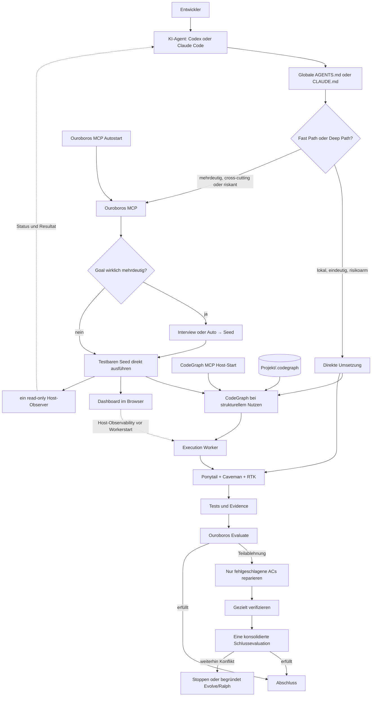

# KISS-Chris-Stack – Produkt-Onboarding

**Release-Stand des KISS-Chris-Stack-Pakets:** 2026.10.05  
**Dokumentationsstand:** 2026-10-05  
**Betriebsform:** lokale, benutzerbezogene Installation für Codex und Claude Code

## Was ist es?

KISS-Chris-Stack ist Chris' portables Installations- und Betriebsprofil für KI-gestützte Softwareentwicklung. Es verbindet mehrere spezialisierte Werkzeuge zu einem einheitlichen Arbeitsablauf:

- Ouroboros für Zielklärung, orchestrierte Ausführung und Evaluation,
- CodeGraph für strukturelle Repository- und Impact-Analyse,
- UI-UX-Pro-Max für UI-/UX-Aufgaben,
- Ponytail für die kleinste robuste Implementierung,
- Caveman für knappe Agentenkommunikation und
- RTK für kompakte, weiterhin überprüfbare Kommandoausgaben.

Das Paket installiert die Werkzeuge, initialisiert projektspezifische Daten, ergänzt die globalen Agentenregeln in einem abgegrenzten Block und richtet die MCP-Server ein.

Der sichtbare Produktname lautet **KISS-Chris-Stack**. Der technische Skill-Identifier und Installationsordner lautet plattformkonform **`kiss-chris-stack`**.

## Verwendungszweck

Der Stack ist für lokale Softwareentwicklungsaufgaben mit einem KI-Agenten vorgesehen. Er soll insbesondere:

- kleine Änderungen ohne unnötige Orchestrierung direkt umsetzen,
- komplexe oder riskante Vorhaben über einen überprüfbaren Deep Path führen,
- vorhandene Repository-Strukturen vor Änderungen sichtbar machen,
- UI-Aufgaben um systematische Design- und Accessibility-Prüfungen ergänzen und
- Installation, Nutzung und Verifikation auf weiteren Entwicklerrechnern reproduzierbar machen.

## Zuständigkeit

| Bestandteil | Zuständig für | Nicht zuständig für |
| --- | --- | --- |
| Ouroboros | starkes Goal, Interview/Seed, Workflow, Evaluation, Repair/Evolve | Repository-Indexierung oder UI-Design |
| CodeGraph | Symbole, Aufrufpfade, Abhängigkeiten und Impact | Anforderungen oder fachliche Entscheidungen |
| UI-UX-Pro-Max | visuelle Gestaltung, Interaktion, Responsivität, Accessibility und UI/UX-Review | reine Backend-, API-, Datenbank- oder Infrastrukturaufgaben |
| Ponytail | Wiederverwendung und kleinste korrekte Implementierung | Weglassen von Sicherheit, Validierung oder Tests |
| Caveman | knappe, klare Agentenkommunikation | Änderung der Code-Semantik |
| RTK | Reduktion von Tool- und Shell-Ausgabe | Unterdrückung notwendiger Fehler- oder Testevidenz |
| Agent-Host | Ausführung der Regeln, Skills, MCP-Tools und Host-Observer | automatische Vergabe von Zugangsdaten oder Benutzerfreigaben |

## Architekturdiagramm



Dashboard und Observer gehören dem Host und werden bei einem Deep Path nach dem Start-Receipt, aber vor den Ausführungs-Workern eingerichtet. Der Observer implementiert keinen Code.

## Kurzanleitung

### Voraussetzungen

- Git
- Node.js mit `npm` und `npx`
- Python 3 als `python`, `python3` oder `py`
- Codex oder Claude Code
- Internetzugang während der Installation

### Installation unter Windows

PowerShell im Ziel-Repository öffnen und ausführen:

```powershell
& 'C:\path\to\KISS-Chris-Stack\scripts\install-stack.ps1' -ProjectPath .
```

### Installation unter macOS, Linux oder WSL

```bash
bash /path/to/KISS-Chris-Stack/scripts/install-stack.sh "$PWD"
```

Die Installation führt nach der Ouroboros-Installation zuerst innerhalb des erkannten KI-Agenten exakt `ooo setup` aus. Nur nach erfolgreichem Abschluss folgen unter anderem UI-UX-Pro-Max mit `uipro init --ai codex` beziehungsweise `uipro init --ai claude`, CodeGraph und die globale Aktivierung.

Danach den Agenten neu starten und den Stack prüfen:

```powershell
& 'C:\path\to\KISS-Chris-Stack\scripts\verify-stack.ps1' -ProjectPath .
```

```bash
bash /path/to/KISS-Chris-Stack/scripts/verify-stack.sh "$PWD"
```

## Nutzungsweise

1. Eine Entwicklungsaufgabe normal an den KI-Agenten geben. Der Stack wird über die globalen Regeln automatisch aktiviert.
2. Der Agent formuliert vor der Umsetzung ein starkes Goal mit Zielzustand, Scope, Constraints, Acceptance Criteria und Verifikation.
3. Kleine, eindeutige Aufgaben laufen im Fast Path direkt.
4. Komplexe, architektonische oder riskante Aufgaben laufen im Deep Path. Nur wirklich mehrdeutige Ziele verwenden `ooo auto "<goal>"`; ein bereits konkretes Goal mit testbaren Acceptance Criteria wird als Seed direkt über `ouroboros_start_execute_seed` gestartet.
5. Bei UI-Aufgaben wird zusätzlich UI-UX-Pro-Max verwendet.
6. Vor nicht-trivialen Änderungen wird CodeGraph initialisiert oder synchronisiert und für fokussierte Strukturfragen genutzt.
7. Ein Deep Path endet erst nach Tests/Evidence und Ouroboros Evaluation.

Wichtige Bedienbefehle:

| Zweck | Befehl |
| --- | --- |
| Ouroboros erstmals einrichten | `ooo setup` |
| Komplexes Goal automatisch bearbeiten | `ooo auto "<goal>"` |
| Status prüfen | `ooo status` |
| CodeGraph neu anlegen | `codegraph init -i <repo>` |
| CodeGraph aktualisieren | `codegraph sync <repo>` |
| UI-UX-Pro-Max für Codex initialisieren | `uipro init --ai codex` |

### Begrenzter Deep Path

| Grenze | Standard |
| --- | --- |
| Interviewrunden | maximal 3 |
| Iterationen pro Acceptance Criterion | maximal 3 |
| Verify-Command | maximal 10 Minuten |
| Ohne beobachtbaren Fortschritt | maximal 15 Minuten |
| Generation-Sicherheitslimit | maximal 60 Minuten |
| Standard-Turns | maximal 6 |
| Auto-Evolution | deaktiviert |
| Evaluation | Stage 1 und 2 aktiv; Stage 3 standardmäßig aus |

Vor der ersten Evaluation werden alle mechanischen Checks ausgeführt und gemeinsam mit Code-, Test-, Evidence- und Dokumentationspfaden übergeben. Nach einer Teilablehnung werden nur die fehlgeschlagenen Acceptance Criteria repariert; anschließend folgt genau eine konsolidierte Schlussevaluation.

## Features

- automatische Fast-/Deep-Path-Auswahl anhand von Komplexität und Risiko,
- verpflichtende Goal- und Verification-Struktur,
- idempotente Installer für Windows und Unix/WSL,
- sichere Abbruchkante, falls `ooo setup` fehlschlägt,
- Installation und Agent-Initialisierung von UI-UX-Pro-Max,
- CodeGraph-Initialisierung oder -Synchronisierung pro Repository,
- automatische Registrierung von Ouroboros- und CodeGraph-MCP,
- markerbasierte Aktualisierung globaler Agentenregeln ohne fremde Inhalte zu überschreiben,
- Windows-Autostart für den Ouroboros-MCP über eine Benutzer-Anmeldeaufgabe,
- Dashboard-Launcher mit Loopback-Prüfung und Wiederherstellung veralteter Ports,
- genau ein read-only Host-Observer pro Deep-Path-Job,
- begrenzte Deep-Path-Laufzeit und höchstens drei Iterationen je Acceptance Criterion,
- direkte Seed-Ausführung für bereits konkrete Goals statt eines unnötigen Interviews,
- fokussierte Reparatur mit einer konsolidierten Schlussevaluation und
- Verifikationsskripte für Installation, MCP, Plugins, Skills, Policies und Dashboard.

## Release-Stand und Versionierung

Das portable KISS-Chris-Stack-Paket trägt den Release-Stand **2026.10.05**. Die Installer verwenden für mehrere externe Komponenten bewusst Rolling Releases wie `@latest` oder den jeweils aktuellen Plugin-Marketplace-Stand. Deshalb ist der Paketstand stabil benannt, die konkret installierten Komponenten werden aber zum Installationszeitpunkt aufgelöst.

Referenzstand der am 2026-10-05 geprüften Entwicklungsumgebung:

| Komponente | Version |
| --- | --- |
| Ouroboros / `ooo` | `0.55.3` |
| CodeGraph | `0.9.2` |
| UI-UX-Pro-Max CLI | `2.15.0` |
| RTK | `0.42.3` |
| Caveman | `0.65.2` |
| Codex CLI | `0.159.0` |
| Claude Code | `2.1.216` |

Diese Tabelle ist ein Referenz-Snapshot und keine feste Abhängigkeitssperre. Für Audits ist die Ausgabe des Verifikationsskripts auf der jeweiligen Zielmaschine maßgeblich.

## Wie zur Verfügung gestellt

Der Stack wird als Ordner oder ZIP-Datei weitergegeben. Das Archiv enthält keine Zugangsdaten und keine vorinstallierten Binärdateien, sondern:

- die Skill-Definition und Agentenmetadaten,
- Windows- und Unix-/WSL-Installer,
- Verifikations- und Dashboard-Helfer,
- die markerbasierte globale Policy,
- Referenzdokumentation und Tests.

Die empfangende Person entpackt das Paket, öffnet das gewünschte Ziel-Repository und startet den passenden Installer mit diesem Repository als `ProjectPath`. Externe Werkzeuge und Plugins werden anschließend aus ihren jeweiligen Quellen installiert.

## Schulungs- und Onboarding-Konzept

Empfohlener Ablauf für neue Nutzer:

1. **Orientierung, 15 Minuten:** Rollen der sechs Stack-Komponenten und Unterschied zwischen Fast Path und Deep Path erklären.
2. **Geführte Installation, 15–30 Minuten:** Voraussetzungen prüfen, Installer im Übungs-Repository starten, `ooo setup` beobachten und Agent neu starten.
3. **Fast-Path-Übung, 15 Minuten:** eine kleine lokale Änderung mit Goal, gezieltem Test und kurzer Evidence umsetzen.
4. **Deep-Path-Übung, 30–45 Minuten:** ein mehrdeutiges Goal mit `ooo auto` und ein konkretes Goal per direktem Seed starten, Dashboard und Observer beobachten und die begrenzte Evaluation nachvollziehen.
5. **UI-Übung, 15 Minuten:** eine kleine Interface-Aufgabe mit UI-UX-Pro-Max und Accessibility-Prüfung durchführen.
6. **Betriebsübergabe:** `verify-stack` erfolgreich ausführen und bekannte Grenzen besprechen.

Onboarding gilt als abgeschlossen, wenn die Person Fast und Deep Path unterscheiden, CodeGraph gezielt einsetzen, Dashboard/Observer korrekt einordnen und eine vollständige Verifikation selbst ausführen kann.

## Betriebsmodell

- **Scope:** lokale Installation pro Betriebssystembenutzer und Projekt.
- **Steuerung:** globale `AGENTS.md` beziehungsweise `CLAUDE.md` aktiviert das Routing; projektspezifische Regeln bleiben zusätzlich gültig.
- **Projektzustand:** CodeGraph speichert den Index im Repository unter `.codegraph`; Ouroboros kann `.ouroboros/mechanical.toml` für deterministische Gates verwenden.
- **MCP unter Windows:** Ouroboros läuft per Streamable HTTP auf `127.0.0.1:8765` und startet über die Benutzer-Anmeldeaufgabe `Ouroboros MCP`; CodeGraph wird durch den Agent-Host verwaltet.
- **MCP unter macOS/Linux/WSL:** der Agent-Host startet die konfigurierten STDIO-MCP-Server.
- **Dashboard:** nur über Loopback, mit dynamischem Dashboard-Port; der Browser wird bei einem Deep Path automatisch geöffnet, sofern eine grafische Sitzung verfügbar ist.
- **Updates:** erneutes Ausführen des Installers aktualisiert Rolling-Komponenten, setzt die begrenzten Deep-Path-Defaults und synchronisiert einen vorhandenen CodeGraph-Index.
- **Kontrolle:** `verify-stack.ps1` oder `verify-stack.sh` ist der operative Abnahmepunkt nach Installation und Update.

## Grenzen – was kann der Stack nicht?

- Er ersetzt keine fachliche Entscheidung und garantiert nicht, dass unklare Anforderungen ohne Rückfragen korrekt sind.
- Er vergibt keine Zugangsdaten, Logins, Provider-Berechtigungen oder Hook-Vertrauensfreigaben automatisch.
- Er arbeitet nicht vollständig offline, weil Werkzeuge und Plugins während der Installation aus externen Quellen bezogen werden.
- Rolling Releases bedeuten, dass zwei zeitlich getrennte Installationen unterschiedliche Komponentenstände erhalten können.
- Die Zeit- und Iterationsgrenzen verhindern Endlosschleifen, garantieren aber nicht, dass ein komplexes Vorhaben innerhalb des Budgets vollständig lösbar ist; notwendige Erweiterungen müssen offengelegt werden.
- Er ist kein zentraler Mehrbenutzer-Service und übernimmt kein organisationsweites Benutzer-, Rechte- oder Secret-Management.
- Er führt keinen Push, Merge, Release oder Deployment ohne entsprechende Benutzerfreigabe aus.
- Auf Headless-/SSH-Systemen kann er den Browser nicht öffnen; dort wird nur die Dashboard-URL ausgegeben.
- Wenn der Agent-Host keine unabhängige Child-Session unterstützt, kann kein echter separater Host-Observer gestartet werden; dies muss transparent gemeldet werden.
- Der Dashboard-Kompatibilitätspatch ist absichtlich eng begrenzt und bricht bei unbekannten Upstream-Strukturen ab, statt fremden Code blind zu verändern.
- CodeGraph versteht Repository-Struktur, ersetzt aber keine Laufzeit-, Integrations- oder Sicherheitstests.

## Weiterführende Dateien

- [Installationsanleitung](../README.md)
- [Skill- und Routing-Regeln](../SKILL.md)
- [Komponentenrollen](../references/stack-policy.md)
- [Global eingespielte Policy](../assets/global-stack-policy.md)
