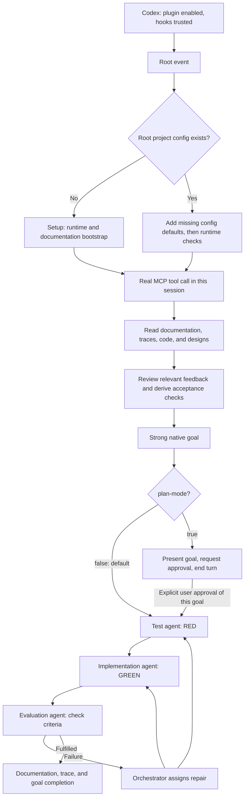

# KISS-Chris-Stack

## What is it?

A Codex plugin with bundled skills, lifecycle hooks, and verified local setup. The root session gathers context and orchestrates separate agents for tests, implementation, and evaluation.

## Purpose

Understand projects, define strong goals, and implement the smallest complete change against reliable criteria. Missing information and decisions are clarified with the user before dependent work.

## Responsibilities

Ponytail minimizes code, Caveman communication, and RTK shell output. CodeGraph provides structure/impact. UI-UX-Pro-Max supports UI tasks with search code and data. The orchestrator manages the goal; test, implementation, and evaluation agents remain separate.

## Architecture diagram

## Quick start

1. Add the GitHub repository marketplace directly, without a manual clone or checkout: `codex plugin marketplace add https://github.com/Chris-1337/KISS-Chris-Stack.git`.
2. Install the plugin: `codex plugin add kiss-chris-stack@kiss-chris-stack`.
3. Reload the host, enable the plugin, and review/approve hooks through the normal host UI.
4. Answer the onboarding question about setting up a project. If yes, provide an explicit absolute path to an existing directory before `/setup` runs. If no, no setup runs; the slash command `/setup` remains available manually, and trusted hooks can initialize the project on a later ordinary task. Onboarding never infers a project from the installation working directory. Node.js, Python 3.10+, and Codex must be available for setup, which checks bundled resources, performs authorized local tool repairs, and requires a real CodeGraph MCP call in this session.
5. Continue the original request through the stack. Optional top-level `"plan-mode": true` in project configuration requires explicit approval of the strong goal before implementation roles start; default false continues automatically. See [configuration](EVALUATION.md). No additional standalone installer is needed.

## Usage

The [shared policy](../assets/global-stack-policy.md) remains authoritative. Installation onboarding takes priority over root readiness instructions until its consent/path dialogue ends. For later ordinary tasks, project-root `kiss-chris-stack.config.json` is the sole initialization indicator: absence invokes setup; presence requires the root to execute the hook-provided `evaluation-config.py --update` argv, validating configuration and adding only missing current defaults before fresh runtime/MCP checks without repeated project initialization. Explicit values remain unchanged. The bare hook remains read-only; pending/declined installation onboarding and delegated roles do not run this updater. Setup creates a missing default config only after successful runtime/session MCP and documentation bootstrap; existing settings remain intact. Invalid configuration blocks setup. Sub-agents do not start recursive goals or setup chains. `docs/` contains human architecture, business decisions, and ADRs; `agent-traces/<component>/` contains brief evidenced goal notes. First-time setup and explicit `/setup` fill documentation gaps and preserve existing files. Documentation and internal reasoning use English; user-facing communication follows the language of the prompt, as recorded in [ADR 0003](adr/0003-documentation-language.md).

## Features

- All stack skills, including the Ponytail suite and UIUX search resources, in the plugin.
- Native Codex marketplace installation with consent-first onboarding and an explicit project path.
- Three stack handlers and three original Ponytail lifecycle handlers.
- Current readiness checks instead of cached success flags.
- Marker-managed global rules preserving unrelated configuration.
- Context before the goal and independent evaluation.
- [Learning from feedback](LEARNING.md): retain scoped lessons, review them before goals and carry prevention checks to all three roles.

## Limits

Automation requires loaded/enabled plugins, available Node.js, and user-trusted hooks. CLI configuration does not prove MCP visibility in the current session. A required reload remains a blocker. Setup neither overwrites MCP conflicts nor approves hooks itself. External writes require user authorization. Complete tool installation from scratch on every platform requires separate verification.

## Release status

As of 2026-10-28: a dedicated repository marketplace plugin with a native Codex manifest. The portable hook-loading limitation in CLI 0.159.0 is documented in the [ADR](adr/0002-codex-marketplace-und-lifecycle.md). Pins are in [versions.json](../assets/versions.json), sources/licenses in [THIRD-PARTY.md](THIRD-PARTY.md).

## Distribution

The repository contains the marketplace and complete plugin. No public directory release is claimed. Usage follows normal marketplace installation and host hook approval.

## Training and onboarding

Guide a small task through setup, context, goal, RED, GREEN, and independent evaluation. People read architecture/ADRs; agents add brief traces. Open limits and decisions remain visible.

## Operating model

The host loads the plugin and starts the registered CodeGraph MCP service. After installation onboarding, ordinary root tasks recheck tools, index, and rules even when project configuration marks initialization complete. Documentation contents never substitute for this marker or current readiness. Updates may require reload or renewed hook review. Readiness requires executable checks and a real session tool call; the checker therefore reports `runtime_ready` separately from overall readiness.
