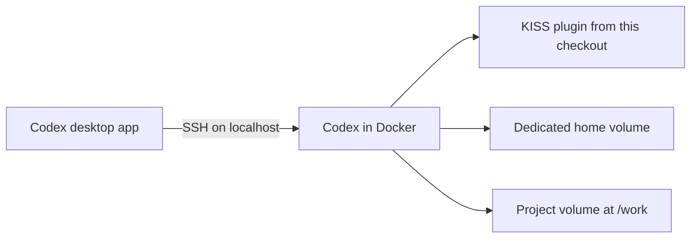

# Encapsulated execution environment

Keep KISS-Chris-Stack's policies, tools and authentication in a dedicated Docker environment while using the graphical Codex desktop app. This is an optional deployment of the existing plugin, not a separate agent persona or browser UI.



The SSH listener is published only on `127.0.0.1:2222`. Password/root login and SSH agent forwarding are disabled. The sole host bind mount contains the dedicated public SSH key, read-only. The private client key stays on the host. Home, project and server host keys use separate named volumes.

The SSH daemon starts as root to protect its server host keys and switch user identities. Authenticated sessions and agent commands run as the unprivileged `node` user. This intentional daemon privilege is separate from allowing root login, which remains disabled.

## Prepare the environment

Prerequisites on the host: Docker with Compose, Python 3.10+, OpenSSH (`ssh` and `ssh-keygen`), and a Codex desktop app with SSH connections. Node.js, Python, Git and Codex CLI are installed inside the image. The image uses Debian 13 because the pinned Linux ARM64 RTK binary requires a newer glibc than Debian 12 provides.

Clone the repository and run from its root:

```sh
python3 containers/remote/prepare.py
```

The helper builds and starts the Compose service, creates a dedicated key pair only when missing, reads the server's public host key directly from the container, and writes these local files:

- `containers/remote/.runtime/id_ed25519`: private client key, not mounted.
- `containers/remote/.runtime/id_ed25519.pub`: public key authorized by the server.
- `containers/remote/.runtime/known_hosts`: pinned container host key.
- `containers/remote/.runtime/ssh_config`: connection fragment with absolute paths.

The entire `.runtime/` directory is ignored by Git. Preparation never copies a host Codex configuration or authentication cache, edits `~/.ssh/config`, or trusts plugin hooks. Repeated preparation preserves an existing private key.

If port 2222 is occupied, set `KISS_SSH_PORT` to an available port before preparation and keep that environment setting for future Compose commands. For example, on macOS/Linux:

```sh
KISS_SSH_PORT=2223 python3 containers/remote/prepare.py
```

The generated SSH fragment and pinned key entry use the selected port.

## Connect the desktop app

1. Review `containers/remote/.runtime/ssh_config` and copy its `Host kiss-container` block into your user SSH config, normally `~/.ssh/config`. Preserve existing entries; if that alias already exists, reconcile it rather than appending a second conflicting entry. The fragment uses this checkout's key and pinned host-key file.
2. Optionally verify SSH without changing your config:

   ```sh
   ssh -F containers/remote/.runtime/ssh_config kiss-container 'codex --version'
   ```

3. In the desktop app, open **Settings > Connections**, add/enable `kiss-container`, then choose the remote project folder `/work`.
4. Start a chat in that remote project. Enable the plugin and review/trust its hooks through the normal supported UI. Complete onboarding with the existing project path `/work`, or run `/setup` there explicitly.

`/work` is at the root of the container's Linux filesystem. It is not a folder in your Mac Finder or Windows Explorer. Choosing the SSH connection and choosing its project folder are separate steps; enabling the connection alone does not start a project chat. The desktop renders the chat while commands and file operations run inside the container.

See the official [desktop SSH connection guide](https://learn.chatgpt.com/docs/remote-connections).

## Sign in inside the container

Use the desktop's supported sign-in flow for the remote environment. If browser login fails at `127.0.0.1:1455`, use device authentication:

```sh
docker compose -f containers/remote/compose.yaml exec --user node agent codex login --device-auth
```

Open the official verification URL printed by Codex, enter its one-time code and confirm the login in your browser. Keep the command running until it reports success. Then reconnect the desktop host if its account view is stale. Device authentication must be permitted by the account/workspace.

Do not paste callback URLs or tokens into chats, and do not copy your host `auth.json` into the image or repository. Credentials created by this login stay in the container's home volume. See [headless authentication](https://learn.chatgpt.com/docs/auth#login-on-headless-devices).

## Permissions and persistence

Docker is the execution boundary. The container config explicitly uses `sandbox_mode = "danger-full-access"` and `approval_policy = "on-request"`: Codex can access everything available to the non-root `node` user inside this environment, including its own login files. Hook trust is still required. Restricted Codex modes need a working nested Linux sandbox; the unprivileged Compose profile does not grant the namespace permissions that bubblewrap requires. See [Codex in containers](https://learn.chatgpt.com/docs/agent-approvals-security).

The container has no privileged mode, host home mount, Docker socket or forwarded SSH agent. Keep those boundaries when adapting the configuration. This profile permits outbound network access; it is not a network allowlist. Additional host mounts explicitly expose their contents and any granted write access to the agent.

The image installs the plugin from this checkout through its local marketplace. New home volumes are seeded with that installation and container-only settings. Existing home volumes are deliberately preserved: rebuilding the image alone does not guarantee that an existing cached plugin installation is refreshed. Use normal local-marketplace plugin management and recheck hook discovery/trust when updating; do not delete a home volume just to refresh the plugin.

`/setup` installs/checks the pinned RTK and CodeGraph tools inside this environment. CLI registration alone does not prove session MCP visibility; the actual remote chat must successfully call CodeGraph. The base profile does not provide a Docker engine/socket inside the container, so optional container-based SonarQube provisioning is unavailable there without a separately designed setup.

Stop the environment while preserving its data:

```sh
docker compose -f containers/remote/compose.yaml stop
```

Restart using the same preparation command. Do not use `down -v` or volume pruning as a routine restart: the volumes contain projects, authentication and host identity. Moving the checkout requires regenerating the SSH fragment so its absolute paths stay correct.

The contribution's verification evidence and remaining limitations are recorded in [the container trace](../agent-traces/remote-container/2026-10-30-encapsulated-environment.md). Windows and fresh interactive desktop onboarding are not claimed as verified by the automated checks.
